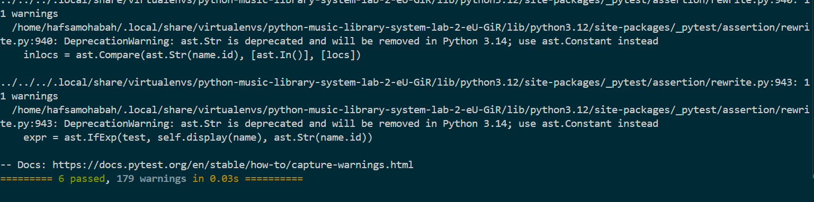

# Music Library System

## Overview

The Music Library System is a Python project that demonstrates object-oriented programming through a `Song` class. It stores information about individual songs and keeps track of statistics across the music library.

## Features

- Create songs with a name, artist, and genre.
- Count the total number of songs created.
- Keep track of unique artists and genres.
- Count how many songs belong to each genre.
- Count how many songs are associated with each artist.

## Song Class

Each song has three instance attributes:

- `name` — the song's name.
- `artist` — the performing artist.
- `genre` — the song's genre.

The class maintains shared attributes:

| Class attribute | Purpose |
|---|---|
| `count` | Tracks the total number of songs. |
| `genres` | Stores unique genres. |
| `artists` | Stores unique artists. |
| `genre_count` | Counts songs by genre. |
| `artist_count` | Counts songs by artist. |
| `artists_count` | An alias for `artist_count`. |

## Class Methods

The class includes five methods that update the shared library statistics when songs are created:

- `add_song_to_count()` — increments the total song count.
- `add_to_genres(genre)` — records a genre if it is not already present.
- `add_to_artists(artist)` — records an artist if they are not already present.
- `add_to_genre_count(genre)` — increments the count for a genre.
- `add_to_artists_count(artist)` — increments the count for an artist.

## Example

```python
from lib.song import Song

song1 = Song("Song One", "Jay Z", "Rap")
song2 = Song("Song Two", "Beyonce", "Pop")
song3 = Song("Song Three", "Jay Z", "Rap")

print(Song.count)
print(Song.genres)
print(Song.artists)
print(Song.genre_count)
print(Song.artist_count)
```

Expected statistics for these three songs:

- Total songs: `3`
- Genres: `["Rap", "Pop"]`
- Artists: `["Jay Z", "Beyonce"]`
- Genre counts: `{"Rap": 2, "Pop": 1}`
- Artist counts: `{"Jay Z": 2, "Beyonce": 1}`

## Project Structure

```text
python-music-library-system-lab/
├── lib/
│   ├── song.py
│   └── testing/
├── screenshots/
│   └── music-library-tests.png
├── Pipfile
├── Pipfile.lock
├── pytest.ini
└── README.md
```

## Installation and Testing

This project uses Python and Pipenv.

Install the development dependencies:

```bash
pipenv install --dev --skip-lock
```

Run the automated tests:

```bash
pipenv run pytest
```

## Test Results

The `Song` class has passed all six provided automated tests.



## Technologies

- Python
- Pipenv
- pytest
